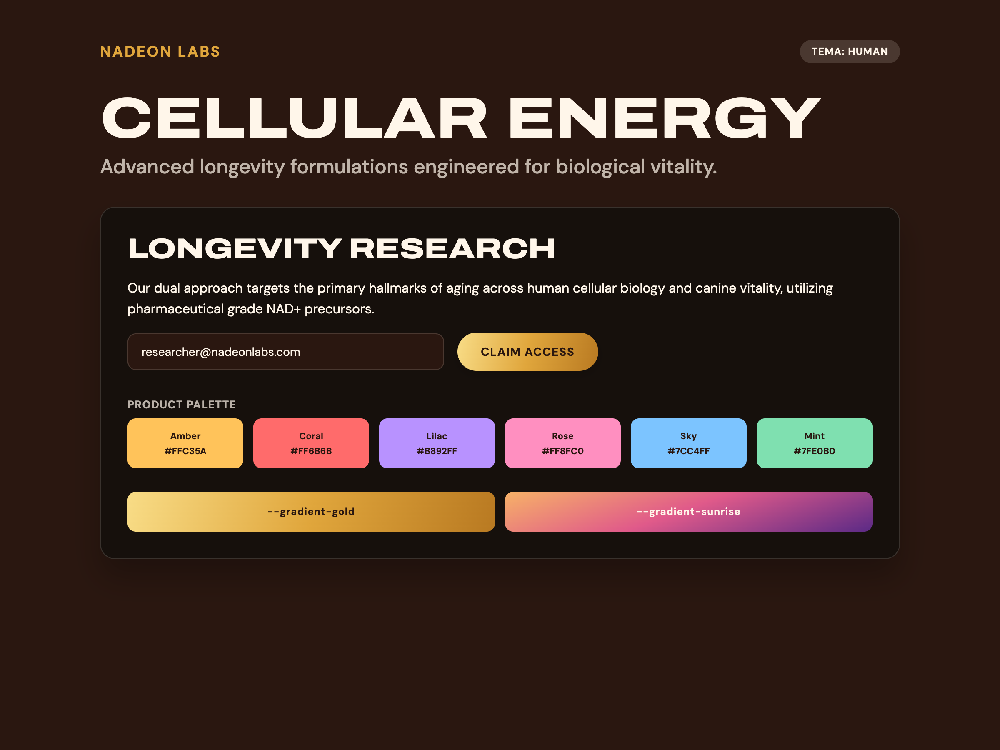
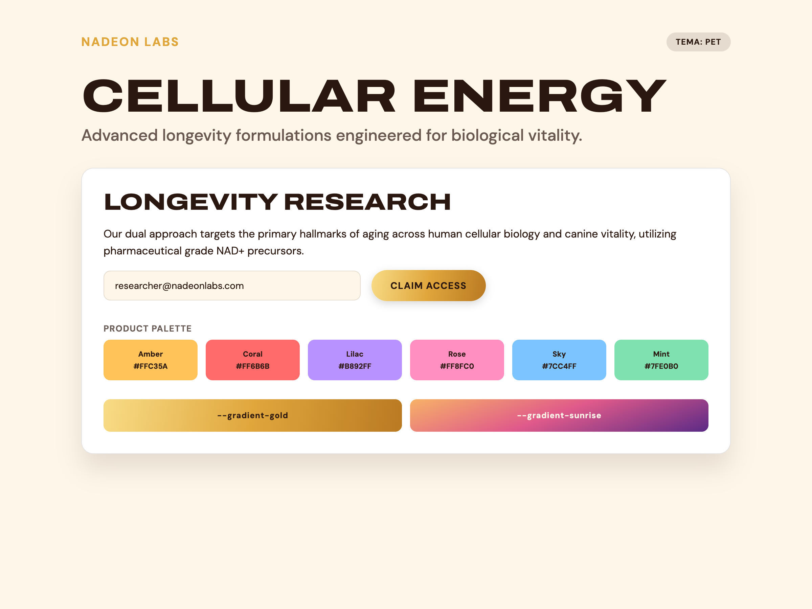

# Levantamento de Design e Auditoria de Tokens

Levantamento realizado de forma automatizada pelo script scripts/design-audit.mjs a partir dos 221 arquivos de telas em design/boards/*.dc.html e especificações em BRAND.md.

## 1. Contagem de Cores Hex

Total de cores unicas identificadas: 232

| Cor Hex     | Ocorrências | Identificação no Brand Kit           |
| ----------- | ----------- | ------------------------------------ |
| `#2A1710`   | 8261        | Espresso (Fundo Human / Texto Pet)   |
| `#FFF6EA`   | 3825        | Cream (Fundo Pet / Texto Human)      |
| `#B97A22`   | 3036        | Gold Dark (parada gradiente)         |
| `#E0A63C`   | 2328        | Gold Mid (parada gradiente / accent) |
| `#F8DC86`   | 2148        | Gold Light (parada gradiente)        |
| `#FFFFFF`   | 2099        | White (Cards e painéis)              |
| `#FFEDB0`   | 1644        | Gold Extra Light (badges / banners)  |
| `#F3CC62`   | 1431        | Gold Amber (links / highlights)      |
| `#16100C`   | 968         | Espresso Dark (bg-elevated Human)    |
| `#FFF6EA33` | 945         | Cor de apoio / detalhe               |
| `#2A171018` | 875         | Cor de apoio / detalhe               |
| `#D9A44333` | 737         | Cor de apoio / detalhe               |
| `#FFF1D6`   | 735         | Cor de apoio / detalhe               |
| `#FFF6EA44` | 652         | Cor de apoio / detalhe               |
| `#2A171022` | 625         | Cor de apoio / detalhe               |
| `#D9A44366` | 517         | Cor de apoio / detalhe               |
| `#2A171014` | 496         | Cor de apoio / detalhe               |
| `#F4EEE6`   | 447         | Cor de apoio / detalhe               |
| `#221812`   | 435         | Espresso Médio (bg secundário)       |
| `#A9CC8E`   | 386         | Cor de apoio / detalhe               |
| `#2A171033` | 351         | Cor de apoio / detalhe               |
| `#F2C95A`   | 338         | Cor de apoio / detalhe               |
| `#FFF6EA22` | 335         | Cor de apoio / detalhe               |
| `#DDEEFB`   | 325         | Cor de apoio / detalhe               |
| `#FF8FC0`   | 321         | Product Rose                         |

## 2. Raios de Borda (border-radius)

Total de variações de raios identificadas: 71

| Raio              | Ocorrências | Token Semântico Mapeado               |
| ----------------- | ----------- | ------------------------------------- |
| `999px`           | 3685        | --radius-pill (botões e badges)       |
| `50%`             | 2870        | --radius-circle (avatares e ícones)   |
| `6px`             | 1133        | --radius-sm / tags                    |
| `18px`            | 824         | --radius-card (cards e painéis)       |
| `20px`            | 600         | --radius-card (cards e painéis)       |
| `12px`            | 578         | --radius-field (inputs e contêineres) |
| `10px`            | 431         | --radius-field (inputs e contêineres) |
| `14px`            | 423         | --radius-field (inputs e contêineres) |
| `16px`            | 397         | --radius-card (cards e painéis)       |
| `8px`             | 248         | --radius-sm / tags                    |
| `22px`            | 216         | Variação específica                   |
| `4px`             | 200         | --radius-sm / tags                    |
| `6px 6px 4px 4px` | 191         | Variação específica                   |
| `9px`             | 131         | Variação específica                   |
| `24px`            | 127         | Variação específica                   |

## 3. Sombras (box-shadow)

Total de variações de sombras identificadas: 55

| Sombra                           | Ocorrências | Aplicação       |
| -------------------------------- | ----------- | --------------- |
| `inset 0 -3px 0 rgba(0,0,0,.15)` | 854         | Cards e frascos |
| `0 22px 36px rgba(0,0,0,.25)`    | 854         | Cards e frascos |
| `0 18px 30px rgba(0,0,0,.25)`    | 140         | Cards e frascos |
| `0 0 0 4px #E0A63C`              | 21          | Cards e frascos |
| `0 0 0 3px #E0A63C`              | 20          | Cards e frascos |
| `0 24px 50px rgba(42,23,16,.12)` | 9           | Cards e frascos |
| `0 30px 60px rgba(0,0,0,.45)`    | 8           | Cards e frascos |
| `0 6px 12px rgba(0,0,0,.25)`     | 8           | Cards e frascos |
| `inset 3px 0 0 #E0A63C`          | 6           | Cards e frascos |
| `inset 3px 0 0 #2A1710`          | 4           | Cards e frascos |

## 4. Tamanhos de Fonte (font-size)

Total de variações de font-size identificadas: 63

| Tamanho | Ocorrências | Uso Observado         |
| ------- | ----------- | --------------------- |
| `14px`  | 7349        | Tipografia do sistema |
| `12px`  | 4328        | Tipografia do sistema |
| `13px`  | 3342        | Tipografia do sistema |
| `11px`  | 2236        | Tipografia do sistema |
| `15px`  | 2068        | Tipografia do sistema |
| `10px`  | 1412        | Tipografia do sistema |
| `16px`  | 1017        | Tipografia do sistema |
| `18px`  | 990         | Tipografia do sistema |
| `22px`  | 829         | Tipografia do sistema |
| `6px`   | 678         | Tipografia do sistema |
| `20px`  | 558         | Tipografia do sistema |
| `17px`  | 499         | Tipografia do sistema |
| `24px`  | 447         | Tipografia do sistema |
| `32px`  | 352         | Tipografia do sistema |
| `30px`  | 295         | Tipografia do sistema |

## 5. Espaçamentos Recorrentes (padding, margin, gap)

| Propriedade e Valor | Ocorrências |
| ------------------- | ----------- |
| `m:10px`            | 4464        |
| `gap:12px`          | 1958        |
| `m:14px`            | 1556        |
| `gap:10px`          | 1362        |
| `m:8px`             | 1336        |
| `m:6px`             | 1192        |
| `p:4px 8px`         | 894         |
| `p:0 6px`           | 859         |
| `gap:8px`           | 823         |
| `gap:16px`          | 821         |
| `m:12px`            | 680         |
| `p:11px 22px`       | 614         |
| `gap:14px`          | 569         |
| `gap:6px`           | 559         |
| `m:16px`            | 532         |

## 6. Gradientes

| Gradiente                                                     | Ocorrências | Token Semântico        |
| ------------------------------------------------------------- | ----------- | ---------------------- |
| `linear-gradient(100deg,#F8DC86 0%,#E0A63C 50%,#B97A22 100%)` | 2137        | --gradient-gold        |
| `linear-gradient(90deg,#3B1A08,#7A3A12 45%,#2A1206)`          | 140         | Gradiente complementar |
| `linear-gradient(160deg,#E2F0D4,#A9CC8E)`                     | 130         | Gradiente complementar |
| `linear-gradient(135deg,#FFEDB0,#FFDCC0,#DDEEFB)`             | 93          | Gradiente complementar |
| `linear-gradient(160deg,#F7B267 0%,#E05A8A 48%,#5B2A86 100%)` | 86          | --gradient-sunrise     |
| `radial-gradient(ellipse at 30% 40%,#3E2E22,#16100C 75%)`     | 67          | Gradiente complementar |
| `linear-gradient(160deg,#FFEDB0,#F2C95A)`                     | 58          | Gradiente complementar |
| `radial-gradient(ellipse at 50% 30%,#7A1640,#2E0716 75%)`     | 52          | Gradiente complementar |
| `radial-gradient(ellipse at 50% 30%,#3E2E22,#16100C 75%)`     | 45          | Gradiente complementar |
| `linear-gradient(135deg,#DDEEFB,#A3CCEF)`                     | 43          | Gradiente complementar |

## 7. Verificação de Contraste WCAG 2.1 AA

Conferência de acessibilidade para pares de cor de texto e fundo em ambos os temas:

| Tema                 | Contexto                                            | Cor Texto                | Cor Fundo                     | Razão de Contraste | Status AA (Normal: 4.5:1, Grande: 3.0:1) |
| -------------------- | --------------------------------------------------- | ------------------------ | ----------------------------- | ------------------ | ---------------------------------------- |
| Human                | Texto principal sobre fundo Espresso                | `#FFF6EA` (Cream)        | `#2A1710` (Espresso)          | 15.97:1            | Passa (AA)                               |
| Human                | Texto principal sobre fundo elevado                 | `#FFF6EA` (Cream)        | `#16100C` (Espresso Elevated) | 17.62:1            | Passa (AA)                               |
| Human                | Texto silenciado (70% opacidade) sobre Espresso     | `#BFB3A9` (Cream 70%)    | `#2A1710` (Espresso)          | 8.33:1             | Passa (AA)                               |
| Human                | Destaque dourado claro sobre Espresso               | `#F8DC86` (Gold Light)   | `#2A1710` (Espresso)          | 12.68:1            | Passa (AA)                               |
| Human                | Destaque dourado médio sobre Espresso               | `#E0A63C` (Gold Mid)     | `#2A1710` (Espresso)          | 7.89:1             | Passa (AA)                               |
| Human                | Botão dourado (Espresso sobre gradiente ouro médio) | `#2A1710` (Espresso)     | `#E0A63C` (Gold Mid)          | 7.89:1             | Passa (AA)                               |
| Human                | Botão dourado claro (Espresso sobre ouro claro)     | `#2A1710` (Espresso)     | `#F8DC86` (Gold Light)        | 12.68:1            | Passa (AA)                               |
| Pet                  | Texto principal sobre fundo Cream                   | `#2A1710` (Espresso)     | `#FFF6EA` (Cream)             | 15.97:1            | Passa (AA)                               |
| Pet                  | Texto principal sobre fundo Card branco             | `#2A1710` (Espresso)     | `#FFFFFF` (White)             | 17.09:1            | Passa (AA)                               |
| Pet                  | Texto silenciado (70% opacidade) sobre Cream        | `#6A5A51` (Espresso 70%) | `#FFF6EA` (Cream)             | 6.14:1             | Passa (AA)                               |
| Pet                  | Texto silenciado (70% opacidade) sobre Card branco  | `#6A5D58` (Espresso 70%) | `#FFFFFF` (White)             | 6.33:1             | Passa (AA)                               |
| Produtos / Badges    | Texto Espresso sobre Amber (#FFC35A)                | `#2A1710` (Espresso)     | `#FFC35A` (Product Amber)     | 10.75:1            | Passa (AA)                               |
| Produtos / Badges    | Texto Espresso sobre Coral (#FF6B6B)                | `#2A1710` (Espresso)     | `#FF6B6B` (Product Coral)     | 6.16:1             | Passa (AA)                               |
| Produtos / Badges    | Texto Espresso sobre Lilac (#B892FF)                | `#2A1710` (Espresso)     | `#B892FF` (Product Lilac)     | 7.00:1             | Passa (AA)                               |
| Produtos / Badges    | Texto Espresso sobre Rose (#FF8FC0)                 | `#2A1710` (Espresso)     | `#FF8FC0` (Product Rose)      | 8.09:1             | Passa (AA)                               |
| Produtos / Badges    | Texto Espresso sobre Sky (#7CC4FF)                  | `#2A1710` (Espresso)     | `#7CC4FF` (Product Sky)       | 9.11:1             | Passa (AA)                               |
| Produtos / Badges    | Texto Espresso sobre Mint (#7FE0B0)                 | `#2A1710` (Espresso)     | `#7FE0B0` (Product Mint)      | 10.74:1            | Passa (AA)                               |
| Gradiente / Destaque | Texto Cream sobre Violet (#6A2FA3)                  | `#FFF6EA` (Cream)        | `#6A2FA3` (Violet)            | 7.70:1             | Passa (AA)                               |

### Conclusões do Contraste

1. O par Human principal (Cream sobre Espresso) atinge 15.97:1, superando com folga o critério WCAG AAA (7.0:1).
2. O par Pet principal (Espresso sobre Cream) atinge 15.97:1, igualmente superior ao critério WCAG AAA.
3. No botão dourado, o texto Espresso sobre o fundo dourado atinge 7.89:1 a 12.68:1, garantindo leitura nítida e aprovação AA.
4. Para as cores de produto (Amber, Coral, Rose, Sky, Mint, Lilac), o uso de texto Espresso (#2A1710) atinge conformidade AA ampla (acima de 6.16:1 em todas as tonalidades).

## 8. Evidência Visual dos Temas

Renderização dos temas Human e Pet com aplicação de tokens semânticos, gradientes, raios de borda e tipografia (Archivo 125% e DM Sans):

- Tema Human: 
- Tema Pet: 
